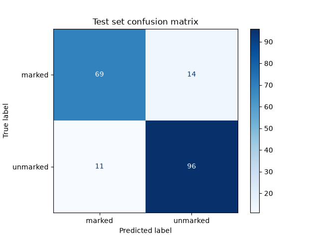
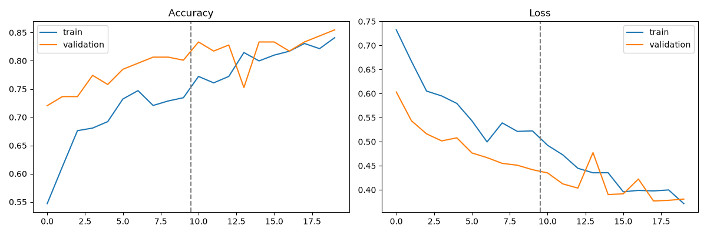

# Tongue Image Classification (Experimental)

> **Disclaimer: experimental project, not a medical tool.**
> This is a learning and portfolio project. It is **not a validated medical diagnostic tool** and must not be used to diagnose, treat, or rule out any condition. For any health concern, consult a qualified healthcare professional.

A computer vision project that classifies grayscale tongue images as **tooth-marked** (`marked`) or **not tooth-marked** (`unmarked`) using transfer learning (MobileNetV2), with a Streamlit app that shows the predicted class, confidence, and a Grad-CAM heatmap.

**Stack:** Python 3.12, TensorFlow/Keras 2.21, OpenCV, scikit-learn, Streamlit.

---

## Results at a glance

Evaluated once on a held-out test set of 190 images that were never used for training or model selection.

|Metric|Value|
|-|-|
|Accuracy|86.8% (165 / 190 correct)|
|ROC AUC|0.923|
|Macro F1|0.866|

|Class|Precision|Recall|F1|Test images|
|-|-|-|-|-|
|marked|0.863|0.831|0.847|83|
|unmarked|0.873|0.897|0.885|107|

Confusion matrix (rows = true class, columns = predicted class):

||pred: marked|pred: unmarked|
|-|-|-|
|**true: marked**|69|14|
|**true: unmarked**|11|96|

With only 190 test images, the 95% confidence interval for accuracy is roughly **82% to 92%**, so treat 86.8% as an approximate figure, not an exact one.




---

## Dataset

* **Source:** ["tooth-marked-tongue" by HANHUI on Kaggle (version 1, about 290 MB):https://www.kaggle.com/datasets/clearhanhui/biyesheji/data?select=marked]
* **License:** [Unknown. The dataset page lists the license as "Unknown", so I assume there is no permission to redistribute. The images are not included in this repository, and figures that contain dataset images are left out]
* **Size:** 1,250 PNG images, grayscale, already cropped to the tongue on a black background (sizes vary).
* **Classes:** `marked` (546 images) and `unmarked` (704 images). Mild imbalance (44% / 56%), handled with class weights.
* **Labels:** [The dataset page has no description, so it is not documented who labeled the images or how. Images are sorted into folders named marked and unmarked, and the page title suggests tooth-marked versus not tooth-marked, but this is not confirmed. The labels were not verified by me or by any clinician.]
* **No duplicates:** no duplicate files were found (checked by file checksum).
* **Not included in this repository.** Download the dataset yourself from the source above and place it as described in "How to run".

**Split (random, seed 42, per class):** 70% train / 15% validation / 15% test.

|Class|Train|Validation|Test|
|-|-|-|-|
|marked|382|81|83|
|unmarked|492|105|107|

---

## Method

1. **Preprocessing:** images resized to 224 x 224; the single grayscale channel is replicated to 3 channels; pixel values scaled to [-1, 1] inside the model.
2. **Augmentation (training only):** horizontal flip, random rotation (up to about 18 degrees), zoom (10%), contrast (10%).
3. **Model:** MobileNetV2 pretrained on ImageNet, global average pooling, dropout 0.3, one sigmoid output.
4. **Training, two stages:**

   * Stage 1: base frozen, train the new top layer (Adam, learning rate 1e-3, up to 10 epochs).
   * Stage 2: unfreeze the last 30 layers of the base (batch-norm layers stay frozen) and fine-tune (Adam, learning rate 1e-5, up to 10 epochs).
   * Class weights for the imbalance; early stopping and checkpointing on validation loss.
5. **Evaluation:** one pass over the untouched test set (`src/evaluate.py`).

The model was trained once and evaluated once on the test set. No repeated retraining to improve the test score.

---

## Explainability (Grad-CAM)

Grad-CAM heatmaps show which image regions most influenced a prediction. I inspected 6 test images per class (the first 6 files alphabetically, not a random sample), so these are qualitative observations only, not proof.


Heatmap images are not shown here because they contain dataset images and the dataset license is unknown. Running `python src\gradcam_check.py` generates them locally.

Observations:

* The model did **not** consistently focus on the left and right tongue borders, where tooth marks appear. Attention varied between images and was often on one side or the lower part of the tongue.
* In several images, especially unmarked ones, strong heat appears near the bottom-right edge, sometimes on the black background outside the tongue. This suggests the model may use cues such as the tongue outline or shape, and it may partly be a border artifact of the network. Grad-CAM on this network is also coarse (a 7 x 7 grid).
* Among these 12 images, unmarked predictions were confident (88% to 99%, all 6 correct), while marked predictions were less certain (51% to 99%, 5 of 6 correct). This matches the lower recall for `marked` on the test set.

Because of this, the reported accuracy should not be read as proof that the model recognizes tooth marks specifically.

---

## Limitations

* **Small dataset:** 1,250 images, and only 190 in the test set, so results have wide uncertainty.
* **No patient IDs:** filenames are timestamps, so the split could not be done by person. If one person has several photos, near-duplicates may appear in both training and test data and inflate the scores.
* **Possible shortcut learning:** the heatmaps suggest the model may use the tongue outline or background cues (see above).
* **Narrow input type:** trained on preprocessed, cropped, grayscale images from a single source. Ordinary phone photos, color images, or different lighting and cameras are very different inputs, and predictions on them are unreliable.
* **Labels are a visual feature, not a diagnosis:** the classes describe an appearance, not a confirmed disease. Nothing in this project establishes a link to any health condition.
* **Confidence is not a probability of being correct.** The sigmoid score is the model's own output and is often overconfident. The app flags results below 65% confidence as uncertain, but that threshold was chosen by hand.

---

## How to run

Tested on Windows with Python 3.12 (TensorFlow 2.21 did not install on Python 3.14).

```
python -m venv venv
venv\Scripts\activate
pip install -r requirements.txt
```

1. Download the dataset and unzip it so the folders are `data/raw/marked/marked` and `data/raw/unmarked/unmarked`.
2. Split: `python src\split_data.py`
3. Check the pipeline (optional): `python src\check_dataset.py`
4. Train: `python src\train.py` (about 10 to 30 minutes on a CPU)
5. Evaluate: `python src\evaluate.py`
6. Heatmap check (optional):- **Label quality is undocumented:** the dataset has no description, so it is unknown who labeled the images and how consistent the labels are. Label errors would lower the ceiling on accuracy and could make the results look different on other data. `
7. App: `streamlit run app.py`

---

## Project structure

```
tongue-classifier/
├── app.py              # Streamlit app (prediction, confidence, Grad-CAM)
├── requirements.txt
├── src/
│   ├── split_data.py   # train/val/test split
│   ├── dataset.py      # data loading, augmentation, class weights
│   ├── check_dataset.py
│   ├── train.py        # two-stage transfer learning
│   ├── evaluate.py     # test-set metrics and plots
│   └── - **Label quality is undocumented:** the dataset has no description, so it is unknown   who labeled the images and how consistent the labels are. Label errors would lower the ceiling on accuracy and could make the results look different on other data.
├── models/             # trained model, class names, test metrics
└── notebooks/          # figures (curves, confusion matrix, heatmaps)
```

---

## Future work

* Split by patient (needs a dataset with patient IDs) for a more reliable test score.
* Mask or remove the background, and test whether performance and heatmaps change.
* Add a second, independent dataset to check how well the model generalizes.
* Calibrate the confidence scores and choose the "uncertain" threshold from validation data.
* Compare with other backbones (for example EfficientNetB0) and report variability across several random seeds.

---

## Disclaimer (again)

This repository is for education and demonstration only. It is not medical advice and not a medical device.

